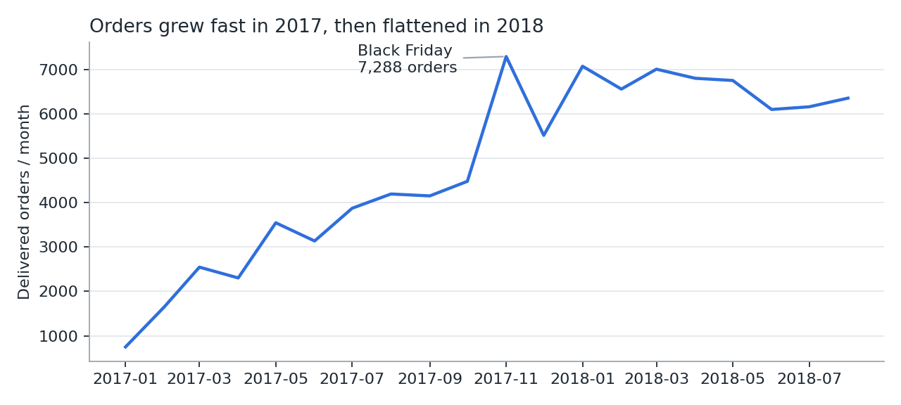
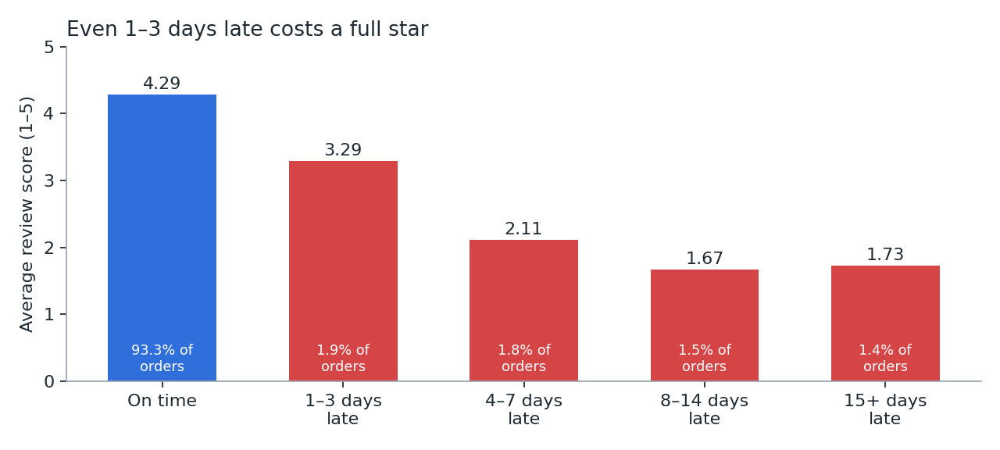
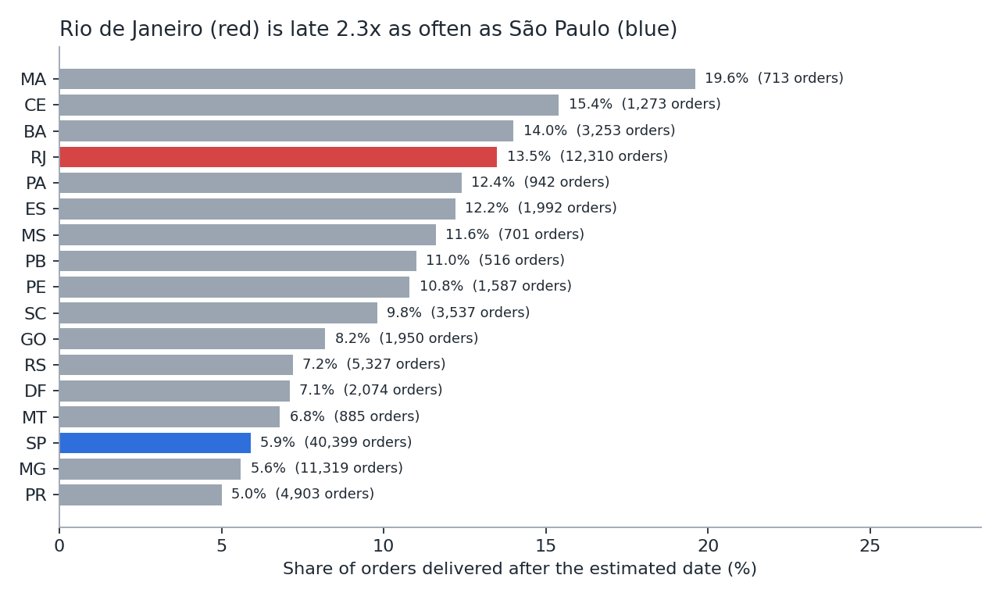

# Olist Brazilian E-commerce: Growth, Delivery Experience and Retention

An end-to-end business analysis of ~96,000 delivered orders from Olist, a Brazilian marketplace
(Jan 2017 – Aug 2018), using **SQL (DuckDB)** and **Python (pandas, matplotlib)**.

> 中文摘要见文末 · Chinese summary at the end.

## Business questions

1. **Growth** – How fast is the business growing, and is growth sustained?
2. **Delivery experience** – How much do late deliveries hurt customer satisfaction, and where do they happen?
3. **Retention** – Do customers come back, and does a good first order make them more likely to?

## Key findings

| # | Finding | Evidence |
|---|---|---|
| 1 | Orders grew **+140% YoY** (Jan–Aug 2018 vs 2017), but monthly volume **plateaued at ~6–7k orders through 2018**. | `sql/01_growth.sql` |
| 2 | **6.7%** of orders arrive after the promised date. Being just **1–3 days late drops the average review from 4.29 to 3.29**; 4–7 days late, 68% of reviews are 1–2 stars. | `sql/02_delivery_vs_review.sql` |
| 3 | Late deliveries concentrate in **Rio de Janeiro (13.5% late, 12k orders)** and the Northeast (MA 19.6%, CE 15.4%, BA 14.0%), vs 5.9% in São Paulo. If RJ matched SP, **~940 late orders** would have been avoided over the period. | `sql/03_late_by_state.sql` |
| 4 | Only **3.0%** of customers ever place a second order. | `sql/04_repeat_purchase.sql` |
| 5 | Surprisingly, first-order satisfaction barely moves repeat rate (**2.7%** after a 1-star first order vs **3.1%** after 5 stars). Low retention is not mainly an experience problem. | `sql/05_first_review_vs_repeat.sql` |





## Recommendations

1. **Set honest delivery estimates for high-risk states.** Reviews are judged against the promised date, not
   absolute speed. A more conservative estimate for RJ and the Northeast could cut "late" orders without any
   logistics change. Trade-off: longer promises may lower conversion, so test it with an **A/B test**
   (metric: review score; guardrail: conversion rate).
2. **Fix logistics where volume is large.** RJ combines a high late rate with the second-largest volume, so
   carrier or warehouse improvements there have the biggest absolute impact.
3. **Treat retention as a separate problem.** Since a great first order does not drive repeat purchase, look
   at category purchase frequency (furniture and watches are naturally infrequent) and at whether customers even
   know they bought through Olist, then test CRM campaigns in high-frequency categories such as health & beauty.

## Limitations

- Public, anonymised dataset; no traffic, marketing spend or conversion data, so the 2018 plateau cannot be
  explained from this data alone.
- Review scores are only available for orders that were reviewed; correlation between delay and score is not proof
  of causation, although the dose-response pattern is strong.

## How to run

```bash
pip install -r requirements.txt
python src/download_data.py   # fetch the raw CSVs into data/raw/
python src/run_analysis.py    # run all SQL, save tables to reports/ and charts to reports/figures/
```

## Project structure

```
sql/        one file per business question (DuckDB SQL, runs directly on the CSVs)
src/        download script and the analysis runner
reports/    query results (CSV) and charts (PNG)
```

Data: [Brazilian E-Commerce Public Dataset by Olist](https://www.kaggle.com/datasets/olistbr/brazilian-ecommerce) (CC BY-NC-SA 4.0).

---

## 中文摘要

用 SQL 和 Python 分析巴西电商平台 Olist 约 9.6 万笔已送达订单（2017 年 1 月至 2018 年 8 月），回答三个业务问题：

- **增长**：2018 年 1–8 月订单同比增长 140%，但全年月订单停在 6–7 千单，增长见顶。
- **配送体验**：6.7% 的订单晚于承诺日期送达；只晚 1–3 天，平均评分就从 4.29 掉到 3.29。晚到集中在里约（13.5%）和东北部各州，圣保罗只有 5.9%。
- **复购**：只有 3.0% 的客户下过第二单；而且首单体验好坏几乎不影响复购（2.7% 对 3.1%），说明复购低主要不是体验问题。

**建议**：对高风险地区给出更保守的预计送达日期并做 A/B 测试；优先改善里约的物流；把复购当成独立问题，从品类购买频率和用户对平台的认知入手。
