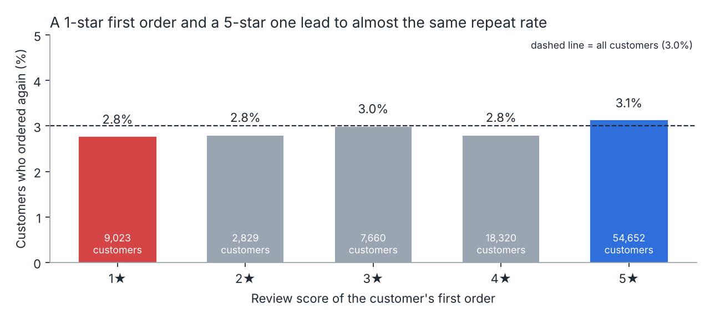
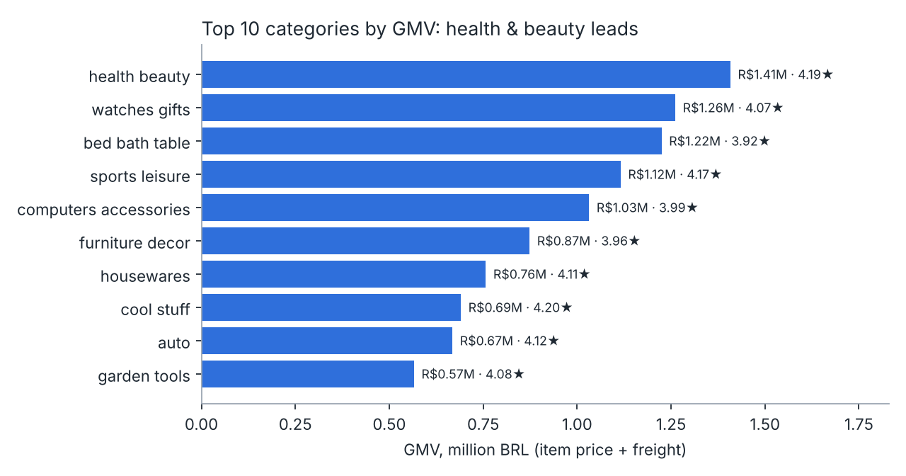

# Olist Brazilian E-commerce: Growth, Delivery and Retention

**[Read the one-page report →](https://irenasikia-svg.github.io/olist-analysis/)**

This project analyses about 96,000 delivered orders from Olist, a Brazilian marketplace, from January 2017 to August 2018. It uses **SQL (DuckDB)** and **Python (pandas, matplotlib)** to answer three business questions and turns the answers into recommendations.

> 中文摘要见文末 · Chinese summary at the end.

## Business questions

1. **Growth.** How fast is the business growing, and is the growth holding up?
2. **Delivery experience.** How much do late deliveries hurt customer satisfaction, and where do they happen?
3. **Retention.** Do customers come back, and does a good first order make them more likely to?

## Key findings

| # | Finding | Evidence |
|---|---|---|
| 1 | Orders grew **140% year on year** (Jan–Aug 2018 vs 2017), but monthly volume **flattened at 6–7k orders throughout 2018**. | `sql/01_growth.sql` |
| 2 | **6.7%** of orders arrive after the promised date. Arriving just **1–3 days late drops the average review from 4.29 to 3.29**. At 4–7 days late, 68% of reviews are 1 or 2 stars. | `sql/02_delivery_vs_review.sql` |
| 3 | Late deliveries cluster in **Rio de Janeiro (12.1% late on 12k orders)** and the Northeast (MA 17.5%, CE 13.8%, BA 12.2%). São Paulo is late only 4.5% of the time. If RJ had matched SP, **about 940 late orders** would have been avoided. | `sql/03_late_by_state.sql` |
| 4 | Only **3.0%** of customers ever place a second order. | `sql/04_repeat_purchase.sql` |
| 5 | **The first-order experience barely changes the repeat rate:** 2.8% after a 1-star first order vs 3.1% after a 5-star one. Low retention is mainly not an experience problem. | `sql/05_first_review_vs_repeat.sql` |
| 6 | Health & beauty is the largest category by GMV (R$1.41M) and is also among the best rated (4.19★). | `sql/06_top_categories.sql` |

An order counts as **late** when it is delivered on a later calendar day than the estimated date. Delivery on the estimated day counts as on time. Findings 2 and 3 use this definition.





## Recommendations

1. **Give honest delivery estimates in high-risk states.** Customers judge an order against the promised date, not against absolute speed. More conservative estimates for RJ and the Northeast could cut "late" orders without any change to logistics. Longer promises may lower conversion, so this should be validated with an **A/B test** (primary metric: review score; guardrail: conversion rate).
2. **Fix logistics where the volume is.** RJ combines a high late rate with the second-largest order volume, so carrier or warehouse improvements there have the biggest absolute impact.
3. **Treat retention as its own problem.** A great first order does not bring customers back. Look first at how often each category is naturally bought (furniture and watches are rare purchases) and at whether customers even know they bought through Olist. Then test CRM campaigns in high-frequency categories such as health & beauty.

## Limitations

- The dataset is public and anonymised. It has no traffic, marketing spend or conversion data, so it cannot explain the 2018 plateau on its own.
- Review scores exist only for orders that were reviewed. The link between delay and score is a correlation, not proof of causation, although the dose-response pattern is strong.

## How to run

```bash
pip install -r requirements.txt
python src/download_data.py   # download the raw CSVs into data/raw/
python src/run_analysis.py    # run every query and save the tables to reports/ and the charts to reports/figures/
```

## Project structure

```
sql/        one DuckDB query per business question (runs directly on the CSVs)
src/        download script and analysis runner
reports/    query results (CSV) and charts (PNG)
index.html  the one-page report published with GitHub Pages
```

## License

- **Code** (`sql/`, `src/`, `index.html`): MIT, see [LICENSE](LICENSE).
- **Data and derived results** (`reports/`): the [Brazilian E-Commerce Public Dataset by Olist](https://www.kaggle.com/datasets/olistbr/brazilian-ecommerce) is licensed under **CC BY-NC-SA 4.0**. The tables and charts in `reports/` are derived from it and are shared under the same licence: non-commercial use only, with attribution to Olist.

---

## 中文摘要

本项目用 SQL 和 Python 分析巴西电商平台 Olist 约 9.6 万笔已送达订单（2017 年 1 月至 2018 年 8 月），围绕三个业务问题展开：

- **增长**：2018 年 1–8 月订单同比增长 140%，但 2018 年全年月订单量一直停在 6–7 千单，增长已经见顶。
- **配送体验**：6.7% 的订单晚于承诺日期送达（在预计当天送达算准时）。只晚 1–3 天，平均评分就从 4.29 降到 3.29。晚到集中在里约（12.1%）和东北部各州，圣保罗只有 4.5%。
- **复购**：只有 3.0% 的客户下过第二单。首单体验好坏对复购几乎没有影响（1 星 2.8%，5 星 3.1%），说明复购低的主要原因不在体验。

**建议**：对高风险地区给出更保守的预计送达日期，并用 A/B 测试验证；优先改善里约的物流；把复购当作独立问题，从品类的购买频率和用户对平台的认知入手。

代码采用 MIT 许可证；数据及 `reports/` 中的衍生结果沿用原数据集的 CC BY-NC-SA 4.0，仅限非商业用途。
